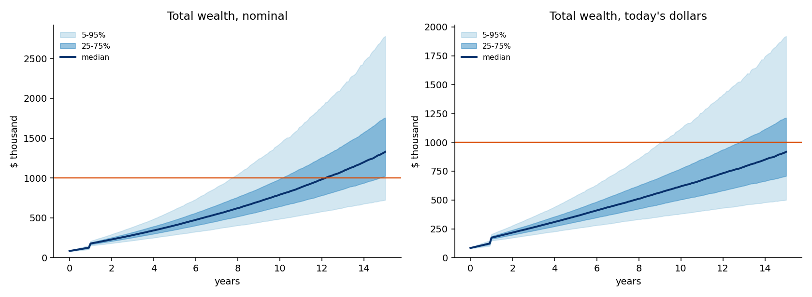
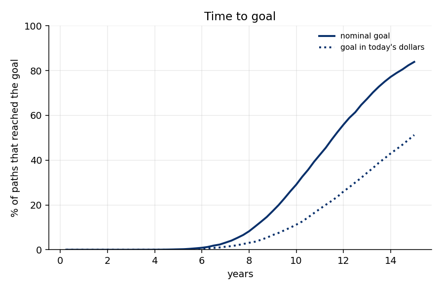

# Portfolio Goal Planner

[](https://github.com/alexboscolo954/portfolio-goal-planner/actions/workflows/tests.yml)

A small, config-driven tool that answers one question: **given what I own, what I save and what might go wrong, what are the odds of reaching a savings goal, and how soon?**

It combines a Monte Carlo simulation of the whole plan (contributions, income gaps, fixed liabilities, one-off foreign-currency inflows, an emergency-cash bucket and a speculative sleeve) with a classic mean-variance analysis, and generates charts and a markdown report from the results.

Everything here is educational. It is not investment, tax or legal advice, and the default return forecasts are placeholders you should replace with your own views.

## What it does

- **Goal-based simulation.** 10,000 paths over monthly steps. Reports the probability of *ever reaching* the goal (first-passage), the median time to reach it, wealth percentiles and drawdowns, in nominal and inflation-adjusted dollars.
- **Realistic cash flows.** Contributions with noise, random income gaps (fixed liabilities such as a mortgage still fall due), a lump sum arriving in a foreign currency at a random exchange rate, a cash reserve that refills first and is drawn first.
- **Two return models.** Correlated Student-t(6) returns with shared tail shocks, and a block bootstrap of actual ETF history re-centred on the forecasts. Agreement between the two is a robustness check.
- **Mean-variance toolkit.** Bounded long-only efficient frontier, max-Sharpe, minimum variance, resampled (Michaud) portfolios, equal-risk-contribution, and a risk-budget view of the whole portfolio.
- **Sensitivities and stress tests.** Contribution level, forecast errors, correlation regime, income gaps, a 2008-style crash early and late, a lost decade, a 2022-style stocks-and-bonds drop.
- **Rule-based rebalancing.** New money buys the most underweight asset; an optional no-sell window (for example a tax-sensitive period) followed by one full rebalance a year with trading costs.

## Quick start

```bash
python3 -m venv .venv && source .venv/bin/activate
pip install -r requirements.txt
python3 run.py examples/example.toml --out results      # about 20 seconds
python3 -m pytest -q                                    # 6 tests
```

Copy `examples/example.toml`, edit the numbers, run again. `results/summary.md` has every table; `results/charts/` the figures.
Set `calibration = "yfinance"` in the `[market]` table to re-estimate correlations from live ETF history (needs internet); the default uses a built-in matrix so runs are offline and reproducible.

## Example result (fictional saver, `examples/example.toml`)

$3,200 a month, a $1,200 monthly liability for 3 years, about $49k arriving in year 1 from a foreign-currency sale, $76k invested today (of which $25k is cash) plus an $8k speculative sleeve. Goal: $1M in today's dollars within 15 years.

| | Today's dollars | Nominal |
|---|---|---|
| Median years to goal | 14.9 | 11.6 |
| Reached within 15 years | 51.2% | 83.9% |



What the example shows (full tables in [`docs/example-results/summary.md`](docs/example-results/summary.md)):

- **Savings rate dominates.** +25% contributions lifts the odds from 51% to 68%; -25% drops them to 33%.
- **Allocation matters less than savings, and saturates.** From 65% to 100% equities the odds move by about 8 points (46% to 54%), against 17 points for +25% savings; 90% and 100% equities score the same, while the typical worst drawdown deepens from -22% to -32%.
- **Doing nothing is expensive.** Leaving cash idle and adding new money in the same mix costs about 13 points (38% vs 51%) against investing it on a schedule.
- **Forecast risk is the biggest unknown.** Equity returns 2 points a year lower cost about 16 points; 2 points higher gain about 15.
- **Mean-variance cannot choose your risk level.** With forecasts this close, expected return per unit of risk is similar across assets, so the efficient frontier is flat and its "optimal" portfolios sit at 5-9% volatility, far below what this goal needs. The goal and horizon decide where on the frontier you should be; the simulation does.
- **A speculative sleeve punches above its weight in risk.** About 9.5% of the example's money is about 28% of its total risk (see `risk.png`).



## Design notes

- **Compound forecasts become log-means.** Published capital-market assumptions are compound (geometric) returns. Feeding them in as arithmetic means makes the median outcome about `vol²/2` too low, so the model sets the monthly log-mean to `ln(1+g)/12` and checks in a test that the median path grows at `g`.
- **First passage, not end of horizon.** A saver who reaches the goal in year 11 and then sees a crash has still reached it. The headline metric is the share of paths that touch the goal at some point, with end-of-horizon wealth reported separately.
- **Paired comparisons.** Random numbers are drawn once and reused, so differences between allocations are not simulation noise.
- **Rebalancing with cash flows.** Contributions are large relative to the portfolio early on, so they do most of the rebalancing without selling anything.
- **Allocation is ranked by goal odds and drawdown, not by Sharpe ratio.** Unconstrained mean-variance gives corner solutions; the bounded and resampled versions are shown for comparison.

## Layout

```
planner/config.py     defaults, TOML loading, asset assumptions
planner/market.py     correlations, Student-t and bootstrap return generators
planner/engine.py     cash flows, allocation rules, portfolio simulation, metrics
planner/mpt.py        frontier, max-Sharpe, resampling, risk parity, risk contributions
planner/analysis.py   runs the grid, sensitivities and stress tests
planner/report.py     charts, JSON, markdown summary
tests/                bookkeeping, tail model, allocation rules, bounds
```

## Limitations

- Returns are independent from month to month (the bootstrap keeps 6-month blocks); there is no valuation or momentum model.
- Default forecasts are rough blends of public 2026 capital-market assumptions (JPMorgan LTCMA, Vanguard VCMM, BlackRock CMA). They disagree with each other by several points a year on equities; use your own.
- Taxes, a withdrawal phase and housing or currency risk beyond the one-off lump sum are not modelled.
- Results describe a model, not a forecast.

## License

MIT, see [LICENSE](LICENSE).
