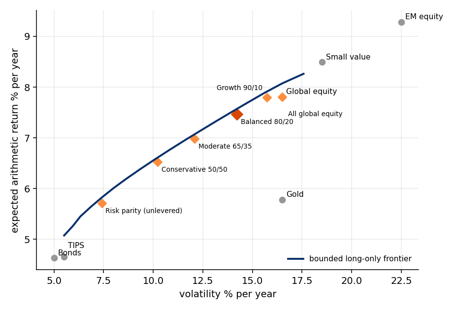
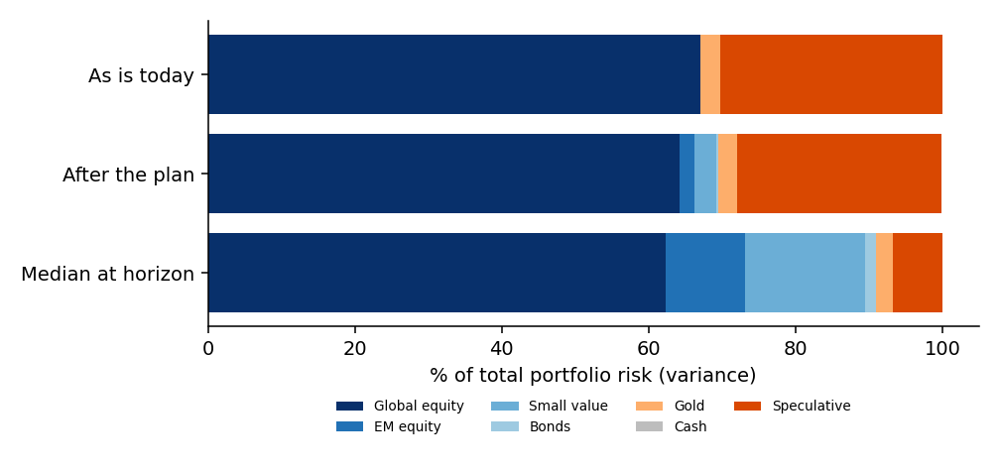

# Results: Balanced 80/20

Goal $1,000,000 in 15 years, inflation 2.5%, 10,000 paths, calibration `default`.

| | Today's dollars | Nominal |
|---|---|---|
| Median years to goal | 14.9 | 11.6 |
| Reached within 15 years | 51.2% | 83.9% |
| Wealth at horizon, p5 / p50 / p95 | $500k / $917k / $1,918k | $724k / $1,328k / $2,778k |

## Allocations compared (Student-t engine)

| Portfolio | Reached (today's $) | Reached (nominal) | Median years (today's $) | Wealth p5 / p50 (today's $) | Core drawdown typical / bad 1-in-10 |
|---|---|---|---|---|---|
| All global equity | 54.0% | 82.9% | 14.5 | $462k / $921k | -32% / -47% |
| Growth 90/10 | 53.9% | 83.7% | 14.5 | $479k / $928k | -30% / -44% |
| Balanced 80/20 **(recommended)** | 51.2% | 83.9% | 14.9 | $500k / $917k | -26% / -40% |
| Moderate 65/35 | 46.2% | 84.3% | >horizon | $530k / $894k | -22% / -33% |
| Conservative 50/50 | 40.7% | 84.7% | >horizon | $554k / $872k | -18% / -27% |
| Risk parity (unlevered) | 28.9% | 84.1% | >horizon | $589k / $829k | -12% / -19% |
| Do nothing (idle cash stays, new money keeps the mix) | 38.0% | 80.3% | >horizon | $527k / $840k | -20% / -30% |
| All new money into global equity (cash and rest stay) | 53.4% | 82.6% | 14.6 | $461k / $918k | -31% / -47% |

## Sensitivities (recommended allocation)

| Change | Reached (today's $) | Reached (nominal) | Median years (today's $) |
|---|---|---|---|
| base | 51.2% | 83.9% | 14.9 |
| contributions $2,400/month | 33.4% | 66.8% | >horizon |
| contributions $4,000/month | 68.4% | 93.5% | 12.9 |
| contributions $4,800/month | 81.7% | 97.5% | 11.4 |
| contributions grow 3%/year | 65.8% | 93.0% | 13.4 |
| income gaps 3x as frequent | 46.5% | 80.2% | >horizon |
| returns 2pp lower (equities), bonds -0.5, gold -1.5 | 35.6% | 72.0% | >horizon |
| returns 2pp higher (equities) | 66.6% | 92.1% | 13.2 |
| stock-bond correlation 0.6 | 51.3% | 83.7% | 14.8 |
| no speculative top-ups | 45.2% | 80.6% | >horizon |
| speculative sleeve goes to zero today (no top-ups) | 40.4% | 78.1% | >horizon |
| speculative bull case (median +8%/year) | 58.6% | 87.1% | 14.0 |
| one-off inflows 25% smaller | 48.8% | 82.5% | >horizon |

## Contribution ladder

| Monthly contribution | Reached (today's $) | Reached (nominal) | Median years (today's $) |
|---|---|---|---|
| $1,920 | 24.1% | 52.7% | >horizon |
| $2,560 | 36.7% | 71.0% | >horizon |
| $3,200 | 51.2% | 83.9% | 14.9 |
| $3,840 | 65.3% | 92.1% | 13.3 |
| $4,480 | 77.0% | 96.4% | 11.9 |
| $5,120 | 85.5% | 98.5% | 10.9 |

## Stress tests

| Shock | Reached (today's $) | Reached (nominal) | Median years (nominal) |
|---|---|---|---|
| 2008-style crash in year 2 | 29.7% | 68.2% | 13.6 |
| 2022-style stocks+bonds crash in year 2 | 38.1% | 75.6% | 12.8 |
| 2008-style crash 2.5 years before the horizon | 30.1% | 61.8% | 11.6 |
| lost decade: equities ~0%/year for years 2-11 | 26.5% | 60.1% | 14.2 |

## Mean-variance portfolios (growth assets)

| Portfolio | Volatility | Expected return | Weights |
|---|---|---|---|
| max Sharpe (bounded) | 8.1% | 6.0% | em_equity 8%, small_value 25%, bonds 60%, gold 7% |
| minimum variance | 5.2% | 4.9% | global_equity 1%, small_value 4%, bonds 60%, tips 30%, gold 5% |
| resampled Sharpe (Michaud) | 8.5% | 6.1% | global_equity 19%, em_equity 7%, small_value 10%, bonds 40%, tips 16%, gold 7% |
| risk parity (ERC) | 7.4% | 5.7% | global_equity 9%, em_equity 7%, small_value 8%, bonds 35%, tips 28%, gold 12% |

